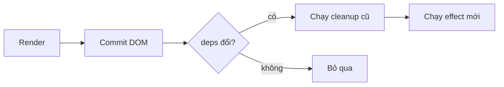

# React useEffect — khi nào chạy?

`useEffect` chạy **sau khi** React vẽ xong giao diện. Mảng phụ thuộc quyết định nó chạy lại lúc nào.

## Vòng đời



## Bảng tóm tắt

| Mảng phụ thuộc | Khi nào chạy |
|---|---|
| không truyền | sau **mọi** lần render |
| `[]` | chỉ một lần sau lần render đầu |
| `[a, b]` | khi `a` hoặc `b` đổi |

> Ghi nhớ: luôn trả về hàm cleanup nếu effect có đăng ký listener hoặc timer.

Xem thêm bài [Event Sourcing](../backend/Event%20Sourcing.html) — hoặc nhảy tới [bảng tóm tắt](#bang-tom-tat).

## Ví dụ code

```tsx
useEffect(() => {
  const id = setInterval(tick, 1000)
  return () => clearInterval(id) // cleanup
}, [tick])
```

## Công thức

Số lần effect chạy sau $n$ lần render khi deps đổi mỗi lần là $n$, còn khi deps rỗng là $1$:

$$
\text{runs}(n) = \begin{cases} n & \text{deps đổi} \\ 1 & \text{deps} = [\,] \end{cases}
$$
